<p align="center">
  <a href="https://gitreels.com/AwesomeZun/Awesome-Showreels"></a>
  <br>
  <a href="https://gitreels.com"></a>
</p>

<div align="center">

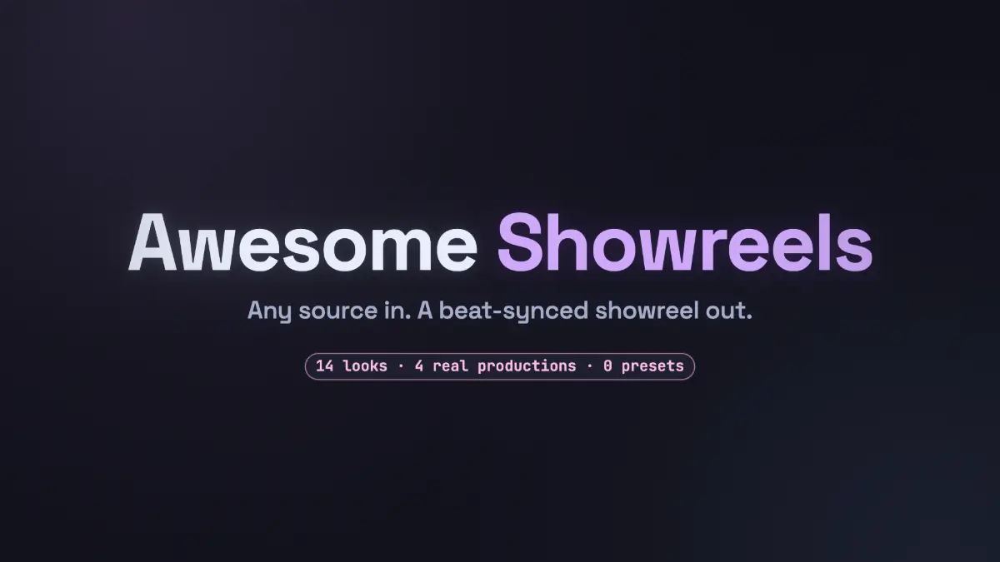

# Awesome Showreels

### A motion-graphics showreel about anything, styled by its own material.

A repo, a paper, a brand, a shop, an event or just an idea: give your agent the material, or a few lines about it, and it designs, scores and renders the reel.<br/>
An agent skill for Claude Code, Codex CLI, Gemini CLI or any coding agent. Delivers an MP4.

<a href="LICENSE"></a>
<a href="#install"></a>


<a href="#bring-your-own-key"></a>

**[Examples](#examples) · [Real productions](#real-productions) · [Features](#features) · [Install](#install) · [FAQ](#faq) · [🇰🇷 한국어](README.ko.md)**

</div>

---

## Examples

Forty example projects, each made from a different kind of source. Sixteen of them are real web apps live at toyz.kr, captured from their own production builds. The style of every reel (palette, type, motion, music) comes from its source, not from a theme list.

<table>
<tr>
<td align="center" valign="top" width="50%">
<a href="https://raw.githack.com/AwesomeZun/Awesome-Showreels/main/skills/motion-showreel/examples/toyz-orbit-note/dist/orbit-note-v1.0.1.html">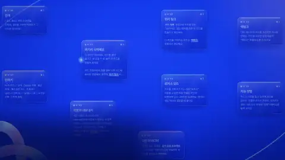</a>
<br/><b>Orbit Note</b> · <code>orbit-note</code>
<br/><sub>a linked-notes app → holographic wiki graph · cinematic 96 BPM</sub>
<br/><sub><a href="https://raw.githack.com/AwesomeZun/Awesome-Showreels/main/skills/motion-showreel/examples/toyz-orbit-note/dist/orbit-note-v1.0.1.html">▶ Play</a> · <a href="skills/motion-showreel/examples/toyz-orbit-note/dist/orbit-note-v1.0.1.html">HTML</a> · <a href="skills/motion-showreel/examples/toyz-orbit-note">Source</a></sub>
</td>
<td align="center" valign="top" width="50%">
<a href="https://raw.githack.com/AwesomeZun/Awesome-Showreels/main/skills/motion-showreel/examples/toyz-offgrid/dist/offgrid-v1.0.0.html">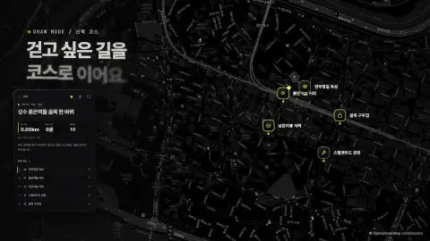</a>
<br/><b>OFFGRID</b> · <code>offgrid</code>
<br/><sub>a local map → one push from Seoul into an alley walk · swing 96 BPM</sub>
<br/><sub><a href="https://raw.githack.com/AwesomeZun/Awesome-Showreels/main/skills/motion-showreel/examples/toyz-offgrid/dist/offgrid-v1.0.0.html">▶ Play</a> · <a href="skills/motion-showreel/examples/toyz-offgrid/dist/offgrid-v1.0.0.html">HTML</a> · <a href="skills/motion-showreel/examples/toyz-offgrid">Source</a></sub>
</td>
</tr>
<tr>
<td align="center" valign="top" width="50%">
<a href="https://raw.githack.com/AwesomeZun/Awesome-Showreels/main/skills/motion-showreel/examples/playful-app/dist/mochi-notes-v1.1.0.html">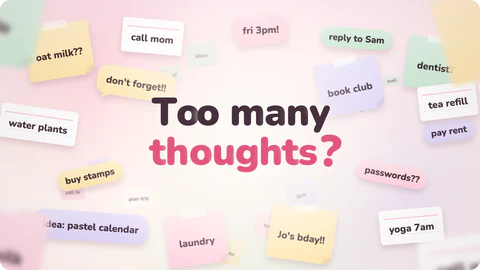</a>
<br/><b>Mochi Notes</b> · <code>playful-app</code>
<br/><sub>an app README → pastel mascot, real app UI · bright pop 120 BPM</sub>
<br/><sub><a href="https://raw.githack.com/AwesomeZun/Awesome-Showreels/main/skills/motion-showreel/examples/playful-app/dist/mochi-notes-v1.1.0.html">▶ Play</a> · <a href="assets/demo-playful-app-v1.1.0.mp4">MP4</a> · <a href="skills/motion-showreel/examples/playful-app/dist/mochi-notes-v1.1.0.html">HTML</a> · <a href="skills/motion-showreel/examples/playful-app">Source</a></sub>
</td>
<td align="center" valign="top" width="50%">
<a href="https://raw.githack.com/AwesomeZun/Awesome-Showreels/main/skills/motion-showreel/examples/pixel-arcade/dist/one-credit-jam-v1.0.0.html">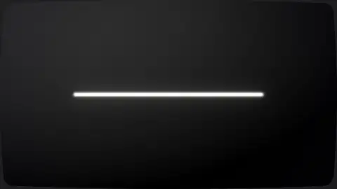</a>
<br/><b>ONE CREDIT JAM</b> · <code>pixel-arcade</code>
<br/><sub>a game jam → pixel art, CRT · chiptune 144 BPM</sub>
<br/><sub><a href="https://raw.githack.com/AwesomeZun/Awesome-Showreels/main/skills/motion-showreel/examples/pixel-arcade/dist/one-credit-jam-v1.0.0.html">▶ Play</a> · <a href="assets/demo-pixel-arcade-v1.0.0.mp4">MP4</a> · <a href="skills/motion-showreel/examples/pixel-arcade/dist/one-credit-jam-v1.0.0.html">HTML</a> · <a href="skills/motion-showreel/examples/pixel-arcade">Source</a></sub>
</td>
</tr>
<tr>
<td align="center" valign="top" width="50%">
<a href="https://raw.githack.com/AwesomeZun/Awesome-Showreels/main/skills/motion-showreel/examples/paper-imaging/dist/zebrafish-light-sheet-v2.0.0.html">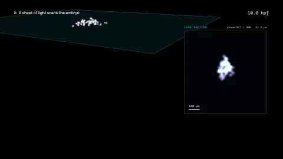</a>
<br/><b>Light-sheet zebrafish embryo</b> · <code>paper-imaging</code>
<br/><sub>a microscopy paper → a sheet of light stacks the embryo · 92 BPM</sub>
<br/><sub><a href="https://raw.githack.com/AwesomeZun/Awesome-Showreels/main/skills/motion-showreel/examples/paper-imaging/dist/zebrafish-light-sheet-v2.0.0.html">▶ Play</a> · <a href="skills/motion-showreel/examples/paper-imaging/dist/zebrafish-light-sheet-v2.0.0.html">HTML</a> · <a href="skills/motion-showreel/examples/paper-imaging">Source</a></sub>
</td>
<td align="center" valign="top" width="50%">
<a href="https://raw.githack.com/AwesomeZun/Awesome-Showreels/main/skills/motion-showreel/examples/swiss-grid/dist/haus-fur-musik-v1.0.0.html">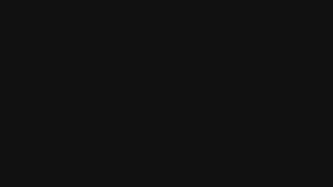</a>
<br/><b>House of Music</b> · <code>swiss-grid</code>
<br/><sub>an architecture brief → 12-column grid, one red · 124 BPM</sub>
<br/><sub><a href="https://raw.githack.com/AwesomeZun/Awesome-Showreels/main/skills/motion-showreel/examples/swiss-grid/dist/haus-fur-musik-v1.0.0.html">▶ Play</a> · <a href="assets/demo-swiss-grid-v1.0.0.mp4">MP4</a> · <a href="skills/motion-showreel/examples/swiss-grid/dist/haus-fur-musik-v1.0.0.html">HTML</a> · <a href="skills/motion-showreel/examples/swiss-grid">Source</a></sub>
</td>
</tr>
<tr>
<td align="center" valign="top" width="50%">
<a href="https://raw.githack.com/AwesomeZun/Awesome-Showreels/main/skills/motion-showreel/examples/explainer-llm/dist/next-word-explainer-v1.0.0.html">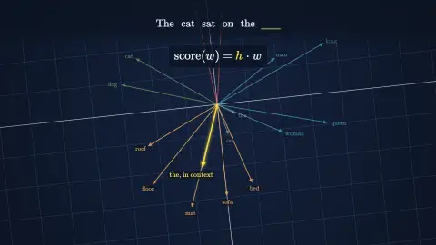</a>
<br/><b>How a language model picks the next word</b> · <code>explainer-llm</code>
<br/><sub>an LLM explainer → words as arrows, maths animation · 15/30/60 s · 96 BPM</sub>
<br/><sub><a href="https://raw.githack.com/AwesomeZun/Awesome-Showreels/main/skills/motion-showreel/examples/explainer-llm/dist/next-word-explainer-v1.0.0.html">▶ Play</a> · <a href="skills/motion-showreel/examples/explainer-llm/dist/next-word-explainer-v1.0.0.html">HTML</a> · <a href="skills/motion-showreel/examples/explainer-llm">Source</a></sub>
</td>
<td align="center" valign="top" width="50%">
<a href="https://raw.githack.com/AwesomeZun/Awesome-Showreels/main/skills/motion-showreel/examples/explainer-sunlight/dist/sunlight-for-breakfast-v1.0.0.html">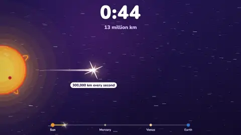</a>
<br/><b>Sunlight for Breakfast</b> · <code>explainer-sunlight</code>
<br/><sub>a science explainer → flat vector, from the Sun to toast · 15/30/60 s · 128 BPM</sub>
<br/><sub><a href="https://raw.githack.com/AwesomeZun/Awesome-Showreels/main/skills/motion-showreel/examples/explainer-sunlight/dist/sunlight-for-breakfast-v1.0.0.html">▶ Play</a> · <a href="skills/motion-showreel/examples/explainer-sunlight/dist/sunlight-for-breakfast-v1.0.0.html">HTML</a> · <a href="skills/motion-showreel/examples/explainer-sunlight">Source</a></sub>
</td>
</tr>
<tr>
<td align="center" valign="top" width="50%">
<a href="https://raw.githack.com/AwesomeZun/Awesome-Showreels/main/skills/motion-showreel/examples/riso-zine/dist/paper-jam-07-v1.0.0.html">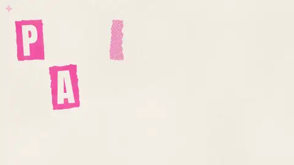</a>
<br/><b>PAPER JAM #07</b> · <code>riso-zine</code>
<br/><sub>a zine → riso inks off register · 160 BPM</sub>
<br/><sub><a href="https://raw.githack.com/AwesomeZun/Awesome-Showreels/main/skills/motion-showreel/examples/riso-zine/dist/paper-jam-07-v1.0.0.html">▶ Play</a> · <a href="assets/demo-riso-zine-v1.0.0.mp4">MP4</a> · <a href="skills/motion-showreel/examples/riso-zine/dist/paper-jam-07-v1.0.0.html">HTML</a> · <a href="skills/motion-showreel/examples/riso-zine">Source</a></sub>
</td>
<td align="center" valign="top" width="50%">
<a href="https://raw.githack.com/AwesomeZun/Awesome-Showreels/main/skills/motion-showreel/examples/sketchnote/dist/visual-notes-lab-v1.0.0.html">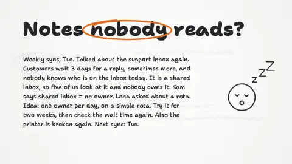</a>
<br/><b>Visual Notes Lab</b> · <code>sketchnote</code>
<br/><sub>a workshop handout → markers that write themselves · 104 BPM</sub>
<br/><sub><a href="https://raw.githack.com/AwesomeZun/Awesome-Showreels/main/skills/motion-showreel/examples/sketchnote/dist/visual-notes-lab-v1.0.0.html">▶ Play</a> · <a href="assets/demo-sketchnote-v1.0.0.mp4">MP4</a> · <a href="skills/motion-showreel/examples/sketchnote/dist/visual-notes-lab-v1.0.0.html">HTML</a> · <a href="skills/motion-showreel/examples/sketchnote">Source</a></sub>
</td>
</tr>
<tr>
<td align="center" valign="top" width="50%">
<a href="https://raw.githack.com/AwesomeZun/Awesome-Showreels/main/skills/motion-showreel/examples/sumi-wabi/dist/yohakuan-v1.0.0.html">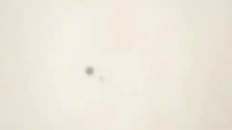</a>
<br/><b>Yohakuan</b> · <code>sumi-wabi</code>
<br/><sub>a ryokan website → sumi ink, vertical type · koto 72 BPM</sub>
<br/><sub><a href="https://raw.githack.com/AwesomeZun/Awesome-Showreels/main/skills/motion-showreel/examples/sumi-wabi/dist/yohakuan-v1.0.0.html">▶ Play</a> · <a href="assets/demo-sumi-wabi-v1.0.0.mp4">MP4</a> · <a href="skills/motion-showreel/examples/sumi-wabi/dist/yohakuan-v1.0.0.html">HTML</a> · <a href="skills/motion-showreel/examples/sumi-wabi">Source</a></sub>
</td>
<td align="center" valign="top" width="50%">
<a href="https://raw.githack.com/AwesomeZun/Awesome-Showreels/main/skills/motion-showreel/examples/paper-perturbseq/dist/perturb-seq-exhaustion-v2.0.0.html">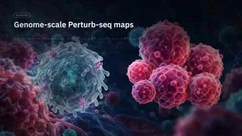</a>
<br/><b>Perturb-seq: T-cell exhaustion</b> · <code>paper-perturbseq</code>
<br/><sub>a CRISPR-screen paper → illustration, data, illustration · 116 BPM</sub>
<br/><sub><a href="https://raw.githack.com/AwesomeZun/Awesome-Showreels/main/skills/motion-showreel/examples/paper-perturbseq/dist/perturb-seq-exhaustion-v2.0.0.html">▶ Play</a> · <a href="skills/motion-showreel/examples/paper-perturbseq/dist/perturb-seq-exhaustion-v2.0.0.html">HTML</a> · <a href="skills/motion-showreel/examples/paper-perturbseq">Source</a></sub>
</td>
</tr>
<tr>
<td align="center" valign="top" width="50%">
<a href="https://raw.githack.com/AwesomeZun/Awesome-Showreels/main/skills/motion-showreel/examples/pixel-pocket/dist/ridgeline-pocket-v2.0.0.html">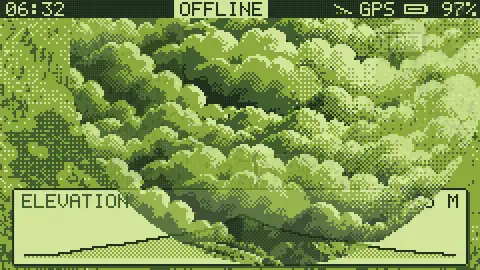</a>
<br/><b>Ridgeline Pocket</b> · <code>pixel-pocket</code>
<br/><sub>a hiking app → a four-green handheld game · chiptune 108 BPM</sub>
<br/><sub><a href="https://raw.githack.com/AwesomeZun/Awesome-Showreels/main/skills/motion-showreel/examples/pixel-pocket/dist/ridgeline-pocket-v2.0.0.html">▶ Play</a> · <a href="skills/motion-showreel/examples/pixel-pocket/dist/ridgeline-pocket-v2.0.0.html">HTML</a> · <a href="skills/motion-showreel/examples/pixel-pocket">Source</a></sub>
</td>
<td align="center" valign="top" width="50%">
<a href="https://raw.githack.com/AwesomeZun/Awesome-Showreels/main/skills/motion-showreel/examples/newsprint/dist/tamsin-valley-courier-v1.0.0.html">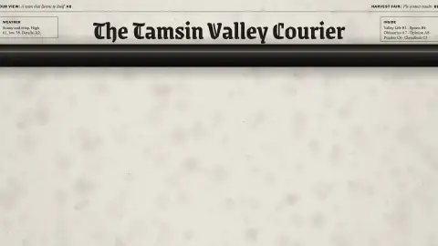</a>
<br/><b>The Tamsin Valley Courier</b> · <code>newsprint</code>
<br/><sub>a local newspaper → printing press, halftone · 96 BPM</sub>
<br/><sub><a href="https://raw.githack.com/AwesomeZun/Awesome-Showreels/main/skills/motion-showreel/examples/newsprint/dist/tamsin-valley-courier-v1.0.0.html">▶ Play</a> · <a href="assets/demo-newsprint-v1.0.0.mp4">MP4</a> · <a href="skills/motion-showreel/examples/newsprint/dist/tamsin-valley-courier-v1.0.0.html">HTML</a> · <a href="skills/motion-showreel/examples/newsprint">Source</a></sub>
</td>
</tr>
<tr>
<td align="center" valign="top" width="50%">
<a href="https://raw.githack.com/AwesomeZun/Awesome-Showreels/main/skills/motion-showreel/examples/toyz-trove/dist/trove-v1.0.1.html">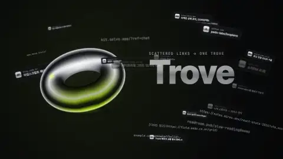</a>
<br/><b>Trove</b> · <code>trove</code>
<br/><sub>a bookmark app → chrome torus, links pulled into orbit · dark synth 128 BPM</sub>
<br/><sub><a href="https://raw.githack.com/AwesomeZun/Awesome-Showreels/main/skills/motion-showreel/examples/toyz-trove/dist/trove-v1.0.1.html">▶ Play</a> · <a href="skills/motion-showreel/examples/toyz-trove/dist/trove-v1.0.1.html">HTML</a> · <a href="skills/motion-showreel/examples/toyz-trove">Source</a></sub>
</td>
<td align="center" valign="top" width="50%">
<a href="https://raw.githack.com/AwesomeZun/Awesome-Showreels/main/skills/motion-showreel/examples/toyz-pulse/dist/pulse-v1.0.1.html">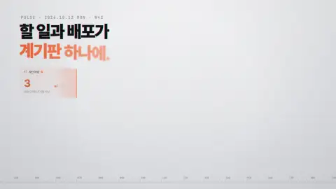</a>
<br/><b>Pulse</b> · <code>pulse</code>
<br/><sub>a maker dashboard → brushed aluminium, live meters · bright pop 112 BPM</sub>
<br/><sub><a href="https://raw.githack.com/AwesomeZun/Awesome-Showreels/main/skills/motion-showreel/examples/toyz-pulse/dist/pulse-v1.0.1.html">▶ Play</a> · <a href="skills/motion-showreel/examples/toyz-pulse/dist/pulse-v1.0.1.html">HTML</a> · <a href="skills/motion-showreel/examples/toyz-pulse">Source</a></sub>
</td>
</tr>
<tr>
<td align="center" valign="top" width="50%">
<a href="https://raw.githack.com/AwesomeZun/Awesome-Showreels/main/skills/motion-showreel/examples/toyz-frame/dist/frame-v1.0.1.html">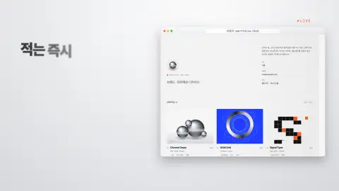</a>
<br/><b>Frame</b> · <code>frame</code>
<br/><sub>a portfolio builder → live preview as you type · corporate 112 BPM</sub>
<br/><sub><a href="https://raw.githack.com/AwesomeZun/Awesome-Showreels/main/skills/motion-showreel/examples/toyz-frame/dist/frame-v1.0.1.html">▶ Play</a> · <a href="skills/motion-showreel/examples/toyz-frame/dist/frame-v1.0.1.html">HTML</a> · <a href="skills/motion-showreel/examples/toyz-frame">Source</a></sub>
</td>
<td align="center" valign="top" width="50%">
<a href="https://raw.githack.com/AwesomeZun/Awesome-Showreels/main/skills/motion-showreel/examples/toyz-tiny-beat/dist/tiny-beat-v1.0.1.html">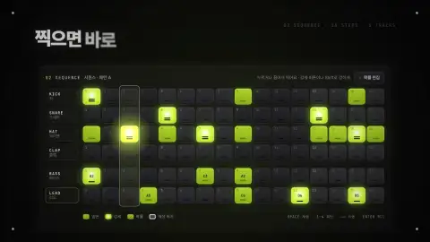</a>
<br/><b>Tiny Beat</b> · <code>tiny-beat</code>
<br/><sub>a daily beat maker → a glowing step sequencer · lo-fi 80 BPM</sub>
<br/><sub><a href="https://raw.githack.com/AwesomeZun/Awesome-Showreels/main/skills/motion-showreel/examples/toyz-tiny-beat/dist/tiny-beat-v1.0.1.html">▶ Play</a> · <a href="skills/motion-showreel/examples/toyz-tiny-beat/dist/tiny-beat-v1.0.1.html">HTML</a> · <a href="skills/motion-showreel/examples/toyz-tiny-beat">Source</a></sub>
</td>
</tr>
<tr>
<td align="center" valign="top" width="50%">
<a href="https://raw.githack.com/AwesomeZun/Awesome-Showreels/main/skills/motion-showreel/examples/toyz-deploy-kit/dist/deploy-kit-v1.0.1.html">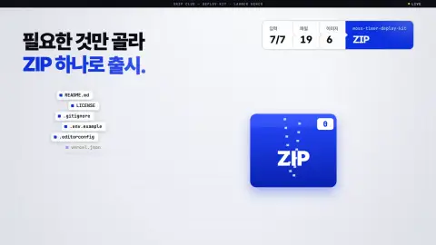</a>
<br/><b>Deploy Kit</b> · <code>deploy-kit</code>
<br/><sub>a launch kit → the files fly into one ZIP · drum and bass 176 BPM</sub>
<br/><sub><a href="https://raw.githack.com/AwesomeZun/Awesome-Showreels/main/skills/motion-showreel/examples/toyz-deploy-kit/dist/deploy-kit-v1.0.1.html">▶ Play</a> · <a href="skills/motion-showreel/examples/toyz-deploy-kit/dist/deploy-kit-v1.0.1.html">HTML</a> · <a href="skills/motion-showreel/examples/toyz-deploy-kit">Source</a></sub>
</td>
<td align="center" valign="top" width="50%">
<a href="https://raw.githack.com/AwesomeZun/Awesome-Showreels/main/skills/motion-showreel/examples/toyz-read-room/dist/read-room-v1.0.1.html">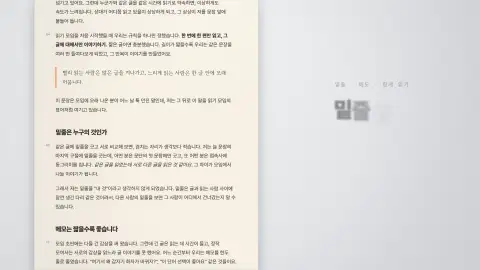</a>
<br/><b>Read Room</b> · <code>read-room</code>
<br/><sub>a shared reading room → highlights drawn at pen speed · ambient 96 BPM</sub>
<br/><sub><a href="https://raw.githack.com/AwesomeZun/Awesome-Showreels/main/skills/motion-showreel/examples/toyz-read-room/dist/read-room-v1.0.1.html">▶ Play</a> · <a href="skills/motion-showreel/examples/toyz-read-room/dist/read-room-v1.0.1.html">HTML</a> · <a href="skills/motion-showreel/examples/toyz-read-room">Source</a></sub>
</td>
</tr>
<tr>
<td align="center" valign="top" width="50%">
<a href="https://raw.githack.com/AwesomeZun/Awesome-Showreels/main/skills/motion-showreel/examples/toyz-motion-kit/dist/motion-kit-v1.0.0.html">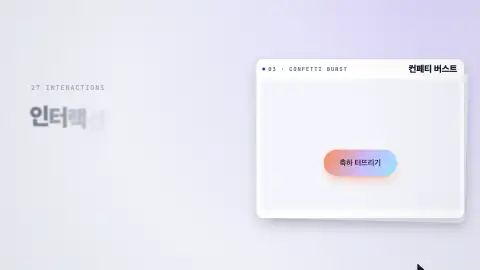</a>
<br/><b>Motion Kit</b> · <code>motion-kit</code>
<br/><sub>a micro-interaction kit → its own animations, frame by frame · bright pop 128 BPM</sub>
<br/><sub><a href="https://raw.githack.com/AwesomeZun/Awesome-Showreels/main/skills/motion-showreel/examples/toyz-motion-kit/dist/motion-kit-v1.0.0.html">▶ Play</a> · <a href="skills/motion-showreel/examples/toyz-motion-kit/dist/motion-kit-v1.0.0.html">HTML</a> · <a href="skills/motion-showreel/examples/toyz-motion-kit">Source</a></sub>
</td>
<td align="center" valign="top" width="50%">
<a href="https://raw.githack.com/AwesomeZun/Awesome-Showreels/main/skills/motion-showreel/examples/toyz-layr/dist/layr-v1.0.0.html">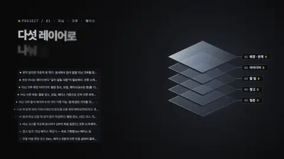</a>
<br/><b>LAYR</b> · <code>layr</code>
<br/><sub>a notes workspace → notes falling onto five glass layers · dark synth 112 BPM</sub>
<br/><sub><a href="https://raw.githack.com/AwesomeZun/Awesome-Showreels/main/skills/motion-showreel/examples/toyz-layr/dist/layr-v1.0.0.html">▶ Play</a> · <a href="skills/motion-showreel/examples/toyz-layr/dist/layr-v1.0.0.html">HTML</a> · <a href="skills/motion-showreel/examples/toyz-layr">Source</a></sub>
</td>
</tr>
<tr>
<td align="center" valign="top" width="50%">
<a href="https://raw.githack.com/AwesomeZun/Awesome-Showreels/main/skills/motion-showreel/examples/toyz-tiny-tools/dist/tiny-tools-v1.0.0.html">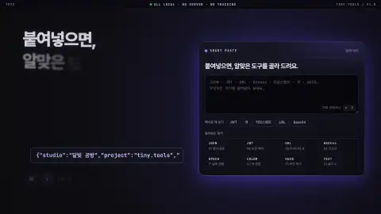</a>
<br/><b>tiny.tools</b> · <code>tiny-tools</code>
<br/><sub>a developer toolbox → smart paste picks the tool · chiptune 128 BPM</sub>
<br/><sub><a href="https://raw.githack.com/AwesomeZun/Awesome-Showreels/main/skills/motion-showreel/examples/toyz-tiny-tools/dist/tiny-tools-v1.0.0.html">▶ Play</a> · <a href="skills/motion-showreel/examples/toyz-tiny-tools/dist/tiny-tools-v1.0.0.html">HTML</a> · <a href="skills/motion-showreel/examples/toyz-tiny-tools">Source</a></sub>
</td>
<td align="center" valign="top" width="50%">
<a href="https://raw.githack.com/AwesomeZun/Awesome-Showreels/main/skills/motion-showreel/examples/toyz-mood-fm/dist/mood-fm-v1.0.0.html">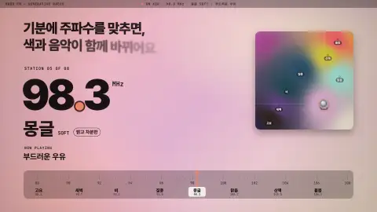</a>
<br/><b>MOOD FM</b> · <code>mood-fm</code>
<br/><sub>a mood radio → the frame takes the colour of the mood · lo-fi 96 BPM</sub>
<br/><sub><a href="https://raw.githack.com/AwesomeZun/Awesome-Showreels/main/skills/motion-showreel/examples/toyz-mood-fm/dist/mood-fm-v1.0.0.html">▶ Play</a> · <a href="skills/motion-showreel/examples/toyz-mood-fm/dist/mood-fm-v1.0.0.html">HTML</a> · <a href="skills/motion-showreel/examples/toyz-mood-fm">Source</a></sub>
</td>
</tr>
<tr>
<td align="center" valign="top" width="50%">
<a href="https://raw.githack.com/AwesomeZun/Awesome-Showreels/main/skills/motion-showreel/examples/toyz-form-01/dist/form-01-v1.0.0.html">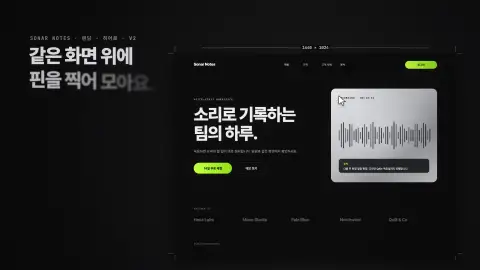</a>
<br/><b>FORM / 01</b> · <code>form-01</code>
<br/><sub>a design feedback board → pins and versions on the work · cinematic 112 BPM</sub>
<br/><sub><a href="https://raw.githack.com/AwesomeZun/Awesome-Showreels/main/skills/motion-showreel/examples/toyz-form-01/dist/form-01-v1.0.0.html">▶ Play</a> · <a href="skills/motion-showreel/examples/toyz-form-01/dist/form-01-v1.0.0.html">HTML</a> · <a href="skills/motion-showreel/examples/toyz-form-01">Source</a></sub>
</td>
<td align="center" valign="top" width="50%">
<a href="https://raw.githack.com/AwesomeZun/Awesome-Showreels/main/skills/motion-showreel/examples/toyz-loop/dist/loop-v1.0.0.html">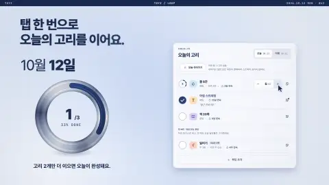</a>
<br/><b>LOOP</b> · <code>loop</code>
<br/><sub>a habit app → taps fill a chrome ring · corporate 128 BPM</sub>
<br/><sub><a href="https://raw.githack.com/AwesomeZun/Awesome-Showreels/main/skills/motion-showreel/examples/toyz-loop/dist/loop-v1.0.0.html">▶ Play</a> · <a href="skills/motion-showreel/examples/toyz-loop/dist/loop-v1.0.0.html">HTML</a> · <a href="skills/motion-showreel/examples/toyz-loop">Source</a></sub>
</td>
</tr>
<tr>
<td align="center" valign="top" width="50%">
<a href="https://raw.githack.com/AwesomeZun/Awesome-Showreels/main/skills/motion-showreel/examples/toyz-focus-space/dist/focus-space-v1.0.0.html">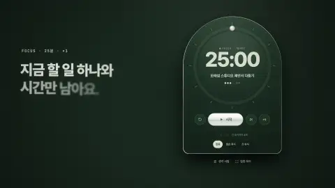</a>
<br/><b>FOCUS SPACE</b> · <code>focus-space</code>
<br/><sub>a focus timer → a session in time-lapse inside an arched door · ambient 96 BPM</sub>
<br/><sub><a href="https://raw.githack.com/AwesomeZun/Awesome-Showreels/main/skills/motion-showreel/examples/toyz-focus-space/dist/focus-space-v1.0.0.html">▶ Play</a> · <a href="skills/motion-showreel/examples/toyz-focus-space/dist/focus-space-v1.0.0.html">HTML</a> · <a href="skills/motion-showreel/examples/toyz-focus-space">Source</a></sub>
</td>
<td align="center" valign="top" width="50%">
<a href="https://raw.githack.com/AwesomeZun/Awesome-Showreels/main/skills/motion-showreel/examples/toyz-pixel-kit/dist/pixel-kit-v1.0.0.html">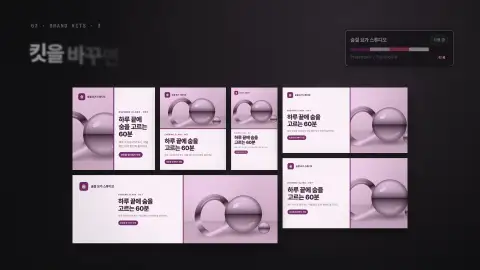</a>
<br/><b>PIXEL KIT</b> · <code>pixel-kit</code>
<br/><sub>a brand-image tool → one design in six sizes, three kits · swing 128 BPM</sub>
<br/><sub><a href="https://raw.githack.com/AwesomeZun/Awesome-Showreels/main/skills/motion-showreel/examples/toyz-pixel-kit/dist/pixel-kit-v1.0.0.html">▶ Play</a> · <a href="skills/motion-showreel/examples/toyz-pixel-kit/dist/pixel-kit-v1.0.0.html">HTML</a> · <a href="skills/motion-showreel/examples/toyz-pixel-kit">Source</a></sub>
</td>
</tr>
<tr>
<td align="center" valign="top" width="50%">
<a href="https://raw.githack.com/AwesomeZun/Awesome-Showreels/main/skills/motion-showreel/examples/neo-brutal/dist/kablok-v1.0.0.html">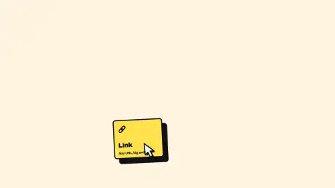</a>
<br/><b>kablok</b> · <code>neo-brutal</code>
<br/><sub>a landing page → hard shadows, slabs · funk 112 BPM</sub>
<br/><sub><a href="https://raw.githack.com/AwesomeZun/Awesome-Showreels/main/skills/motion-showreel/examples/neo-brutal/dist/kablok-v1.0.0.html">▶ Play</a> · <a href="assets/demo-neo-brutal-v1.0.0.mp4">MP4</a> · <a href="skills/motion-showreel/examples/neo-brutal/dist/kablok-v1.0.0.html">HTML</a> · <a href="skills/motion-showreel/examples/neo-brutal">Source</a></sub>
</td>
<td align="center" valign="top" width="50%">
<a href="https://raw.githack.com/AwesomeZun/Awesome-Showreels/main/skills/motion-showreel/examples/editorial-luxe/dist/maison-veyrande-v1.0.0.html">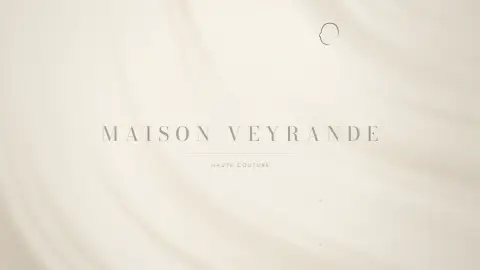</a>
<br/><b>Maison Veyrande</b> · <code>editorial-luxe</code>
<br/><sub>a fashion press release → Bodoni, ivory and black · piano 80 BPM</sub>
<br/><sub><a href="https://raw.githack.com/AwesomeZun/Awesome-Showreels/main/skills/motion-showreel/examples/editorial-luxe/dist/maison-veyrande-v1.0.0.html">▶ Play</a> · <a href="assets/demo-editorial-luxe-v1.0.0.mp4">MP4</a> · <a href="skills/motion-showreel/examples/editorial-luxe/dist/maison-veyrande-v1.0.0.html">HTML</a> · <a href="skills/motion-showreel/examples/editorial-luxe">Source</a></sub>
</td>
</tr>
<tr>
<td align="center" valign="top" width="50%">
<a href="https://raw.githack.com/AwesomeZun/Awesome-Showreels/main/skills/motion-showreel/examples/paper-behaviour/dist/gut-metabolite-anxiety-v1.0.0.html">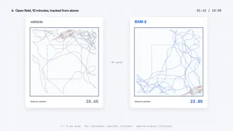</a>
<br/><b>Gut metabolite and anxiety</b> · <code>paper-behaviour</code>
<br/><sub>a mouse-behaviour paper → tracks seen from above · 104 BPM</sub>
<br/><sub><a href="https://raw.githack.com/AwesomeZun/Awesome-Showreels/main/skills/motion-showreel/examples/paper-behaviour/dist/gut-metabolite-anxiety-v1.0.0.html">▶ Play</a> · <a href="skills/motion-showreel/examples/paper-behaviour/dist/gut-metabolite-anxiety-v1.0.0.html">HTML</a> · <a href="skills/motion-showreel/examples/paper-behaviour">Source</a></sub>
</td>
<td align="center" valign="top" width="50%">
<a href="https://raw.githack.com/AwesomeZun/Awesome-Showreels/main/skills/motion-showreel/examples/botanical-organic/dist/mistfold-v1.0.0.html">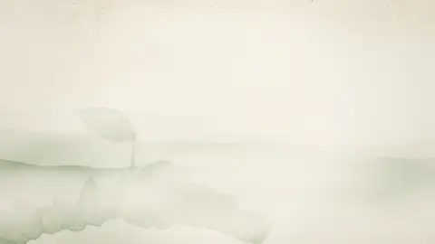</a>
<br/><b>Mistfold</b> · <code>botanical-organic</code>
<br/><sub>a tea brand story → watercolour, growth time-lapse · guitar 96 BPM</sub>
<br/><sub><a href="https://raw.githack.com/AwesomeZun/Awesome-Showreels/main/skills/motion-showreel/examples/botanical-organic/dist/mistfold-v1.0.0.html">▶ Play</a> · <a href="assets/demo-botanical-organic-v1.0.0.mp4">MP4</a> · <a href="skills/motion-showreel/examples/botanical-organic/dist/mistfold-v1.0.0.html">HTML</a> · <a href="skills/motion-showreel/examples/botanical-organic">Source</a></sub>
</td>
</tr>
<tr>
<td align="center" valign="top" width="50%">
<a href="https://raw.githack.com/AwesomeZun/Awesome-Showreels/main/skills/motion-showreel/examples/pixel-isometric/dist/pebble-and-bean-v2.1.0.html">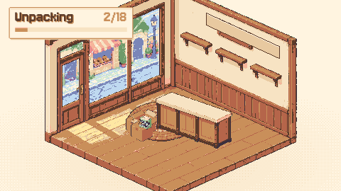</a>
<br/><b>Pebble & Bean</b> · <code>pixel-isometric</code>
<br/><sub>a café opening → cosy isometric pixel art in 16 pastels · lo-fi 86 BPM</sub>
<br/><sub><a href="https://raw.githack.com/AwesomeZun/Awesome-Showreels/main/skills/motion-showreel/examples/pixel-isometric/dist/pebble-and-bean-v2.1.0.html">▶ Play</a> · <a href="skills/motion-showreel/examples/pixel-isometric/dist/pebble-and-bean-v2.1.0.html">HTML</a> · <a href="skills/motion-showreel/examples/pixel-isometric">Source</a></sub>
</td>
<td align="center" valign="top" width="50%">
<a href="https://raw.githack.com/AwesomeZun/Awesome-Showreels/main/skills/motion-showreel/examples/sports-kinetic/dist/velmora-42-v1.0.0.html">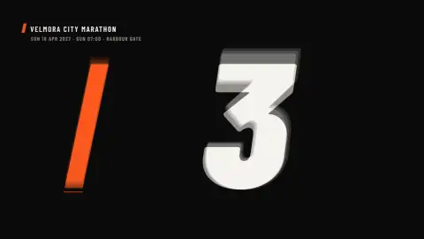</a>
<br/><b>VELMORA 42</b> · <code>sports-kinetic</code>
<br/><sub>a race-timing app → broadcast type, real splits · drum and bass 176 BPM</sub>
<br/><sub><a href="https://raw.githack.com/AwesomeZun/Awesome-Showreels/main/skills/motion-showreel/examples/sports-kinetic/dist/velmora-42-v1.0.0.html">▶ Play</a> · <a href="assets/demo-sports-kinetic-v1.0.0.mp4">MP4</a> · <a href="skills/motion-showreel/examples/sports-kinetic/dist/velmora-42-v1.0.0.html">HTML</a> · <a href="skills/motion-showreel/examples/sports-kinetic">Source</a></sub>
</td>
</tr>
<tr>
<td align="center" valign="top" width="50%">
<a href="https://raw.githack.com/AwesomeZun/Awesome-Showreels/main/skills/motion-showreel/examples/art-deco/dist/the-emerald-fan-v1.0.0.html">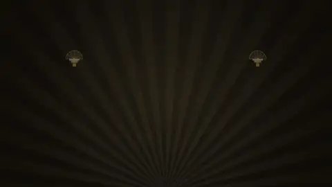</a>
<br/><b>THE EMERALD FAN</b> · <code>art-deco</code>
<br/><sub>a jazz-age invitation → gilded frames · swing 112 BPM</sub>
<br/><sub><a href="https://raw.githack.com/AwesomeZun/Awesome-Showreels/main/skills/motion-showreel/examples/art-deco/dist/the-emerald-fan-v1.0.0.html">▶ Play</a> · <a href="assets/demo-art-deco-v1.0.0.mp4">MP4</a> · <a href="skills/motion-showreel/examples/art-deco/dist/the-emerald-fan-v1.0.0.html">HTML</a> · <a href="skills/motion-showreel/examples/art-deco">Source</a></sub>
</td>
<td align="center" valign="top" width="50%">
<a href="https://raw.githack.com/AwesomeZun/Awesome-Showreels/main/skills/motion-showreel/examples/research-cli/dist/spark-bench-v1.1.0.html">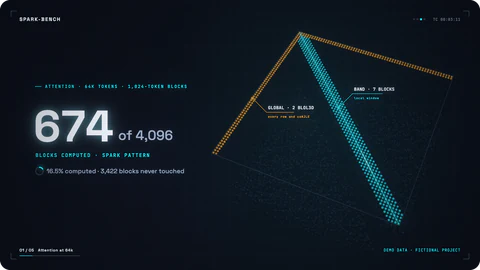</a>
<br/><b>spark-bench</b> · <code>research-cli</code>
<br/><sub>a research CLI → GPU points, real terminal · dark synth 128 BPM</sub>
<br/><sub><a href="https://raw.githack.com/AwesomeZun/Awesome-Showreels/main/skills/motion-showreel/examples/research-cli/dist/spark-bench-v1.1.0.html">▶ Play</a> · <a href="assets/demo-research-cli-v1.1.0.mp4">MP4</a> · <a href="skills/motion-showreel/examples/research-cli/dist/spark-bench-v1.1.0.html">HTML</a> · <a href="skills/motion-showreel/examples/research-cli">Source</a></sub>
</td>
</tr>
<tr>
<td align="center" valign="top" width="50%">
<a href="https://raw.githack.com/AwesomeZun/Awesome-Showreels/main/skills/motion-showreel/examples/academic-paper/dist/alveolar-repair-atlas-v2.0.0.html">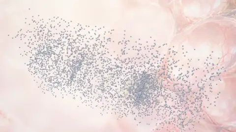</a>
<br/><b>Alveolar repair atlas v2</b> · <code>academic-paper</code>
<br/><sub>a single-cell paper → one nucleus, tissue to 3D atlas and back · 96 BPM</sub>
<br/><sub><a href="https://raw.githack.com/AwesomeZun/Awesome-Showreels/main/skills/motion-showreel/examples/academic-paper/dist/alveolar-repair-atlas-v2.0.0.html">▶ Play</a> · <a href="skills/motion-showreel/examples/academic-paper/dist/alveolar-repair-atlas-v2.0.0.html">HTML</a> · <a href="skills/motion-showreel/examples/academic-paper">Source</a></sub>
</td>
<td align="center" valign="top" width="50%">
<a href="https://raw.githack.com/AwesomeZun/Awesome-Showreels/main/skills/motion-showreel/examples/pixel-jrpg/dist/lanternforge-v2.1.0.html">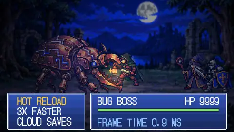</a>
<br/><b>Lanternforge 2.0</b> · <code>pixel-jrpg</code>
<br/><sub>a game-engine release → HD-2D JRPG trailer, real light on pixel art · 120 BPM</sub>
<br/><sub><a href="https://raw.githack.com/AwesomeZun/Awesome-Showreels/main/skills/motion-showreel/examples/pixel-jrpg/dist/lanternforge-v2.1.0.html">▶ Play</a> · <a href="skills/motion-showreel/examples/pixel-jrpg/dist/lanternforge-v2.1.0.html">HTML</a> · <a href="skills/motion-showreel/examples/pixel-jrpg">Source</a></sub>
</td>
</tr>
<tr>
<td align="center" valign="top" width="50%">
<a href="https://raw.githack.com/AwesomeZun/Awesome-Showreels/main/skills/motion-showreel/examples/paper-transformer/dist/attention-explainer-v1.0.0.html">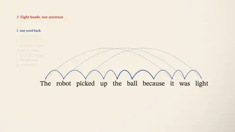</a>
<br/><b>Attention Is All You Need, explained</b> · <code>paper-transformer</code>
<br/><sub>a landmark paper → typeset like the paper, attention computed · 110 BPM</sub>
<br/><sub><a href="https://raw.githack.com/AwesomeZun/Awesome-Showreels/main/skills/motion-showreel/examples/paper-transformer/dist/attention-explainer-v1.0.0.html">▶ Play</a> · <a href="skills/motion-showreel/examples/paper-transformer/dist/attention-explainer-v1.0.0.html">HTML</a> · <a href="skills/motion-showreel/examples/paper-transformer">Source</a></sub>
</td>
<td align="center" valign="top" width="50%">
<a href="https://raw.githack.com/AwesomeZun/Awesome-Showreels/main/skills/motion-showreel/examples/paper-organoid/dist/wnt-pulse-organoids-v2.0.0.html">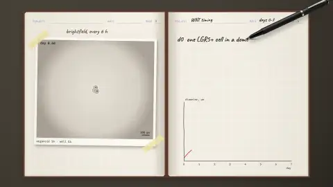</a>
<br/><b>WNT-pulse organoids</b> · <code>paper-organoid</code>
<br/><sub>an organoid paper → a lab notebook that keeps itself · 100 BPM</sub>
<br/><sub><a href="https://raw.githack.com/AwesomeZun/Awesome-Showreels/main/skills/motion-showreel/examples/paper-organoid/dist/wnt-pulse-organoids-v2.0.0.html">▶ Play</a> · <a href="skills/motion-showreel/examples/paper-organoid/dist/wnt-pulse-organoids-v2.0.0.html">HTML</a> · <a href="skills/motion-showreel/examples/paper-organoid">Source</a></sub>
</td>
</tr>
</table>

<sub>Each loop is one moment of the reel at real speed, without sound. <b>▶ Play</b> opens the full reel in your browser with music, where you can switch between its lengths (the same file is in each folder's <code>dist/</code>: 1–5 MB, opens offline, number keys switch lengths). Projects and data are fictional and labelled as such on screen (the sixteen toyz.kr apps are real; the data they show is their own fictional sample data); the two explainers and the Transformer explainer cover real ideas, with toy models or rounded textbook values, and say so.</sub>

<details>
<summary><b>Style decisions per example</b></summary>

| Example | Source | Mood | Palette | Type | Motion | Music (BPM) |
|---|---|---|---|---|---|---|
| `academic-paper` | single-cell paper | airy, precise | blush · coral | Source Serif 4 | 3D nuclei, tissue ↔ atlas | corporate 96 |
| `art-deco` | invitation | opulent, nocturnal | black · gold | Limelight | symmetrical | swing 112 |
| `botanical-organic` | tea brand story | calm, earthy | oat · leaf green | Fraunces | slow | guitar 96 |
| `deploy-kit` | launch kit | brisk, technical | paper · cobalt | Pretendard | file streams | drum and bass 176 |
| `editorial-luxe` | press release | elegant, quiet | ivory · champagne | Bodoni Moda | slow | piano 80 |
| `explainer-llm` | LLM explainer notes | curious, lucid | navy · yellow | KaTeX Main | maths animation | ambient 96 |
| `explainer-sunlight` | science notes | wondrous, bright | violet · sun gold | Nunito | flat-vector dives | bright pop 128 |
| `focus-space` | focus timer | quiet, deep | deep green · chrome | Pretendard | time-lapse | ambient 96 |
| `form-01` | feedback board | precise, editorial | ink · metal · pin colours | Pretendard | pins, versions | cinematic 112 |
| `frame` | portfolio builder | clean, quick | paper · orange | Pretendard | live typing | corporate 112 |
| `layr` | notes workspace | calm, structured | near-black · steel · lime | Pretendard | glass layers | dark synth 112 |
| `loop` | habit app | steady, friendly | periwinkle · navy | Pretendard | a ring that fills | corporate 128 |
| `mood-fm` | mood radio | warm, chromatic | the mood's own colour | Pretendard | dial sweeps | lo-fi 96 |
| `motion-kit` | interaction kit | playful, exact | electric blue · orange | Pretendard | app animations replayed | bright pop 128 |
| `neo-brutal` | landing page | loud, blunt | cream · lemon | Archivo | hard snaps | funk 112 |
| `newsprint` | newspaper | factual, civic | newsprint · red | Newsreader | steady | piano 96 |
| `offgrid` | local map app | nocturnal, local | night map · lime | Pretendard | one camera push | swing 96 |
| `orbit-note` | linked-notes app | luminous, connected | electric blue · holo | Pretendard | drawn links | cinematic 96 |
| `paper-behaviour` | mouse-behaviour paper | clean, precise | white · blue | Instrument Sans | tracked from above | corporate 104 |
| `paper-imaging` | light-sheet paper | luminous, patient | black · green | Manrope | GPU nuclei | ambient 92 |
| `paper-organoid` | organoid paper | warm, hands-on | paper · magenta | Literata | handwritten notebook | corporate 100 |
| `paper-perturbseq` | CRISPR-screen paper | precise, nocturnal | night · orchid | IBM Plex Sans | illustration ↔ data | dark synth 116 |
| `paper-transformer` | landmark paper | elegant, exact | cream · vermilion | STIX Two | typeset | cinematic 110 |
| `pixel-arcade` | game jam | chunky, punchy | night · gold | Press Start 2P | stepped | chiptune 144 |
| `pixel-isometric` | café opening | cosy, warm | cream · latte | Jersey 10 | isometric pixel | lo-fi 86 |
| `pixel-jrpg` | engine release | heroic, nostalgic | night · lantern gold | Pixelify Sans | HD-2D light | cinematic 120 |
| `pixel-kit` | brand-image tool | crafty, consistent | near-black · orchid | Pretendard | a wall that turns over | swing 128 |
| `pixel-pocket` | hiking app | calm, outdoorsy | four greens | 5×7 bitmap | dithered tone steps | chiptune 108 |
| `playful-app` | app README | playful, bouncy | light · pink | Nunito | springy | bright pop 120 |
| `pulse` | maker dashboard | crisp, instrumental | aluminium · orange | Pretendard | meters, snaps | bright pop 112 |
| `read-room` | reading room | quiet, literary | paper · marker orange | Pretendard | pen-speed highlights | ambient 96 |
| `research-cli` | research CLI | technical, cool | dark · cyan | Space Grotesk | damped | dark synth 128 |
| `riso-zine` | zine | loud, scrappy | newsprint · fluo pink | Anton | jumpy | lo-fi 160 |
| `sketchnote` | workshop handout | hand-drawn, friendly | whiteboard · orange | Shantell Sans | handwritten | bright 104 |
| `sports-kinetic` | race-timing app | energetic, exact | track black · orange | Barlow Condensed | fast | drum and bass 176 |
| `sumi-wabi` | ryokan site | quiet, restrained | washi · one vermilion | Shippori Mincho | very slow | koto 72 |
| `swiss-grid` | architecture brief | precise, ordered | paper · one red | Schibsted Grotesk | on the grid | synth 124 |
| `tiny-beat` | beat maker | warm, rhythmic | black · lime | Pretendard | on the step grid | lo-fi 80 |
| `tiny-tools` | developer toolbox | crisp, nimble | night · violet | Pretendard | paste and answer | chiptune 128 |
| `trove` | bookmark app | sleek, nocturnal | black · lime | Pretendard | orbit, chrome | dark synth 128 |

Each folder's <code>style.json</code> records every decision and the evidence from the source behind it.

</details>

---

## Real productions

The method comes from four real projects made before this repo.

<table>
<tr>
<td align="center" valign="top" width="50%">
<a href="https://github.com/AwesomeZun/FDDD"></a>
<br/><b>FDDD</b> · research data reel · 128 BPM
<br/><sub><a href="https://raw.githack.com/AwesomeZun/FDDD/main/showreel/dist/fddd-showreel-en-v1.1.0.html">▶ Play</a> · <a href="https://github.com/AwesomeZun/FDDD">Repo</a></sub>
</td>
<td align="center" valign="top" width="50%">
<a href="https://github.com/AwesomeZun/CC-statusline"></a>
<br/><b>CC-statusline</b> · terminal tool reel
<br/><sub><a href="https://raw.githubusercontent.com/AwesomeZun/CC-statusline/main/assets/reel.gif">▶ Play</a> · <a href="https://github.com/AwesomeZun/CC-statusline">Repo</a></sub>
</td>
</tr>
<tr>
<td align="center" valign="top" width="50%">
<a href="assets/case-kbeautygate-30s-v1.0.0.mp4">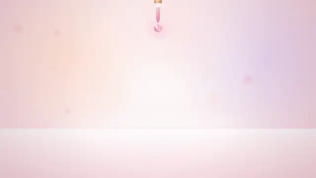</a>
<br/><b>K-BeautyGate</b> · hackathon pitch reel · 120 BPM
<br/><sub><a href="assets/case-kbeautygate-30s-v1.0.0.mp4">▶ MP4 (30 s)</a></sub>
</td>
<td align="center" valign="top" width="50%">
<a href="https://flygate.kr/showreel/FlyGate_showreel_v4.3.0.html">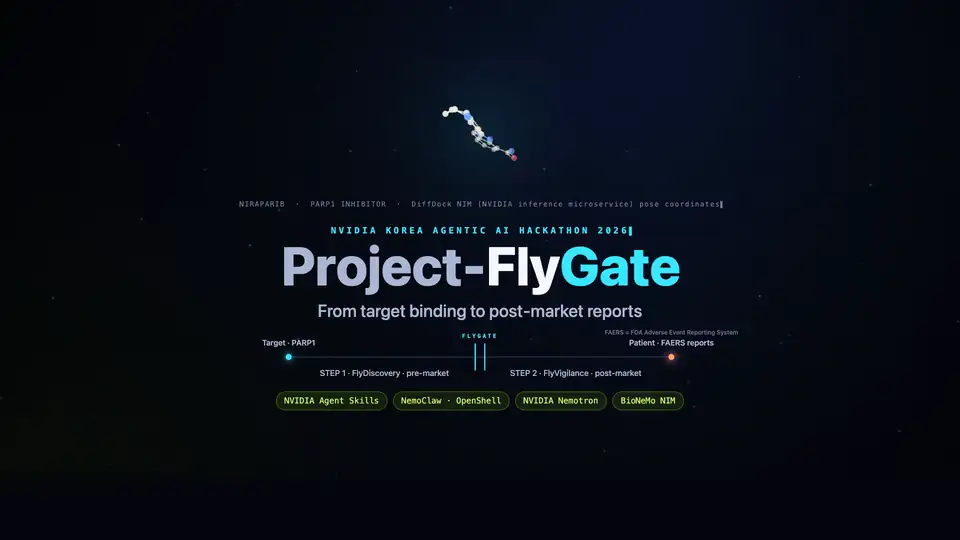</a>
<br/><b>FlyGate</b> · narrated research reel
<br/><sub><a href="https://flygate.kr/showreel/FlyGate_showreel_v4.3.0.html">▶ Play</a> · <a href="https://flygate.kr/showreel/FlyGate_showreel_v4.3.0.mp4">MP4</a> · <a href="https://github.com/AwesomeZun/Project-FlyGate">Repo</a></sub>
</td>
</tr>
</table>

---

## Features

<p align="center"><b>Style from your source</b><br/>Palette, type, pace and music are read from your material, with the evidence written down. No presets.</p>
<p align="center">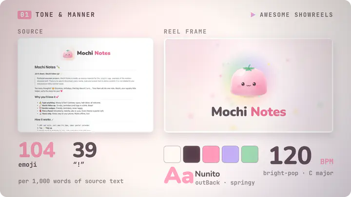</p>

<p align="center"><b>Real material, not decoration</b><br/>Your app's UI, your CLI's output, your paper's figures, your data. Code-drawn motion around it.</p>
<p align="center">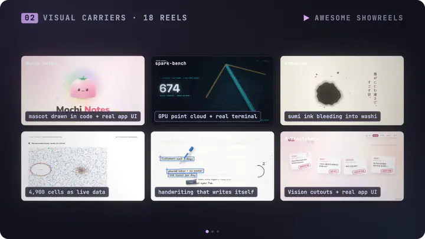</p>

<p align="center"><b>Any length</b><br/>15, 30 or 60 s from one plan. Longer cuts add scenes; nothing is slowed down.</p>
<p align="center">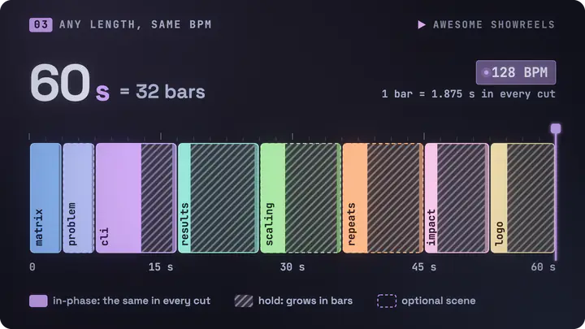</p>

<p align="center"><b>Music and sound effects included</b><br/>Synthesized to fit the style, from koto to drum and bass, and timed to the picture.</p>
<p align="center">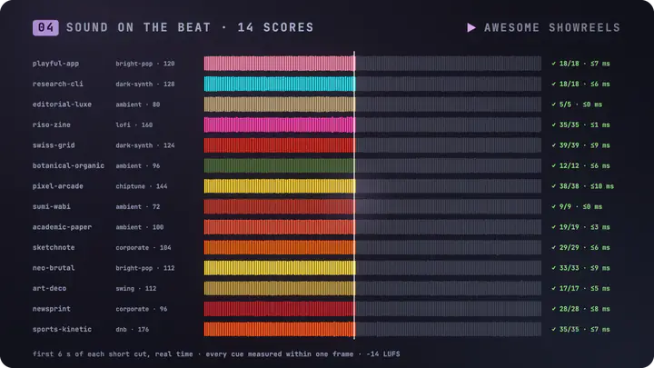</p>

<p align="center"><b>Optional narration</b><br/>Gemini TTS on your own key, checked by speech-to-text, with captions.</p>
<p align="center">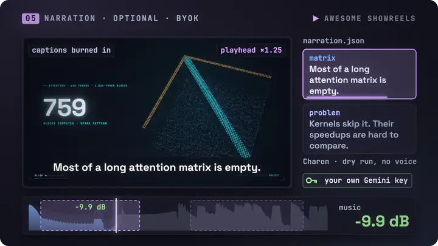</p>

<p align="center"><b>Ready to share</b><br/>An MP4 for each length, plus a web version: one 1–2 MB HTML file with every length and its music. It opens in any browser without internet, switches length with the number keys, steps frame by frame for review, and can be sent in a chat or played from a link.</p>
<p align="center">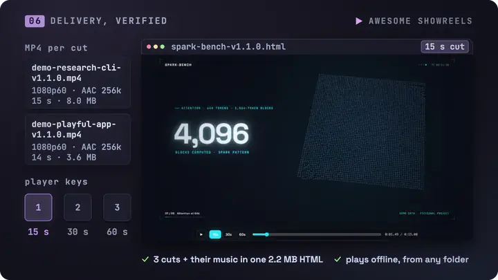</p>

---

## How it works

1. **Read the source.** Measure palette, fonts, tone and density; write `style.json` with the reasons.
2. **Storyboard.** One message per scene; exact wording and disclaimers fixed up front.
3. **Pick the proof.** Real UI, real terminal output, real figures, real numbers.
4. **Plan the cuts.** All lengths on one beat grid.
5. **Build and score.** Scenes are code; music and SFX are synthesized from the same cue list.
6. **Check and ship.** Stills, motion and audio checks, then MP4 and HTML.

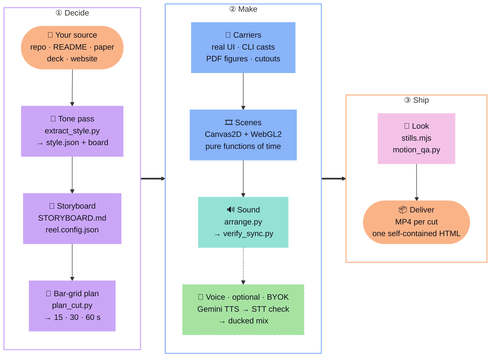

---

## Install

The skill is a folder of instructions (`SKILL.md`) and command-line tools, so any coding agent can use it.

**Claude Code**

```
/plugin marketplace add AwesomeZun/Awesome-Showreels
/plugin install awesome-showreels@awesome-showreels
```

**Codex CLI (OpenAI)**

```bash
git clone https://github.com/AwesomeZun/Awesome-Showreels.git
mkdir -p ~/.codex/skills && cp -r Awesome-Showreels/skills/motion-showreel ~/.codex/skills/
```

**Gemini CLI**

```bash
gemini extensions install https://github.com/AwesomeZun/Awesome-Showreels
```

**Any other agent:** clone the repo and tell the agent to follow `skills/motion-showreel/SKILL.md` (the repo's `AGENTS.md` points there).

**One-time setup** (the agent runs it on first use):

```bash
cd <skill folder>/runtime && npm install
python3 -m pip install numpy scipy pillow opencv-python pymupdf fonttools brotli
```

---

## Prompts to try

| | Ask your agent |
|---|---|
| 📦 **Repo** | *Make a 30-second showreel from this repo, plus a 15-second cut.* |
| 📄 **Paper** | *Turn `paper.pdf` into a 45-second explainer using the paper's own figures.* |
| 🖼️ **Deck** | *Make a launch teaser from `pitch.pptx` in the deck's colors and fonts.* |
| ⌨️ **CLI** | *Make a 15-second reel with a real terminal capture of `mytool demo`.* |
| 🎤 **Narration** | *Narrate the 30-second cut with my Gemini key.* |
| ⏱️ **Longer** | *Make a 60-second version of the reel.* |
| 💡 **Just an idea** | *Make a 20-second reel for my bakery's weekend market: sourdough, cinnamon buns, Saturday 9 to 1.* |

---

## FAQ

<details>
<summary><b>Do I need an API key?</b></summary>

No. Everything renders on your machine and the music is synthesized locally. Only the optional narration needs a key: your own Gemini key (see [Bring your own key](#bring-your-own-key)).

</details>

<details>
<summary><b>What does it cost?</b></summary>

The skill is free (MIT). Building a reel uses your agent's plan like any other task. Narration and extra mascot poses use your own accounts, and only when you agree.

</details>

<details>
<summary><b>Is anything in the examples faked?</b></summary>

The projects are fictional and say so on screen. What they show is real: captured app UI, real terminal recordings, data from the example's own files.

</details>

<details>
<summary><b>Vertical or square video?</b></summary>

Yes, as a re-layout of the same project (`"size": [1080, 1920]` or `[1080, 1080]`), not a crop.

</details>

<details>
<summary><b>Can it use my own mascot or logo?</b></summary>

Yes. Images become clean cutouts (macOS Vision or OpenCV) that blink, bounce and squash on the beat.

</details>

<details>
<summary><b>What is the HTML file?</b></summary>

The web version of the reel: one small file with every length and its music. Open it in any browser, even offline. Space plays and pauses, ← → step, number keys switch cuts, F is fullscreen.

</details>

<details>
<summary><b>Under the hood</b></summary>

- **Runtime:** Canvas2D + WebGL2; every frame is a function of time, so stills, MP4 and the web version match exactly.
- **Planner:** `timing/plan_cut.py` lays every cut on one bar grid; longer cuts add scenes and holds.
- **Audio:** `audio/synth.py`, `arrange.py`, `verify_sync.py` (numpy/scipy, no samples): presets from ambient to chiptune, swing and drum and bass; every cue checked against the picture, -14 LUFS.
- **Captures:** `tools/capture_ui.mjs` (app UI), `capture_cli.py` (terminal), `pdf_figures.py` (paper figures), `prep_assets.py` + `lift.swift` (cutouts).
- **Narration:** `narration/tts_gemini.py` with speech-to-text checks, ducking and captions.
- **Big reels:** `templates/showreel-workflow.js` splits the work across many agents on Claude Code; other agents run the same steps in order.
- **This page:** every preview was rendered by the skill from [`docs/readme-reel/`](docs/readme-reel/).

</details>

---

## Requirements

| | Needed for |
|---|---|
| Node.js 20+ and Chrome/Chromium | rendering stills, MP4 and the web version |
| ffmpeg | MP4 and audio encoding |
| Python 3.9+ with numpy, scipy, Pillow, opencv-python | style pass, planner, music, cutouts |
| *Optional:* pymupdf, fonttools + brotli | PDFs, font subsets |
| *Optional:* macOS 14+ with `swiftc` | Vision cutouts (OpenCV elsewhere) |
| *Optional:* your Gemini API key | narration |

---

## Bring your own key

Narration is the only feature that needs a key, and it is off unless you ask for it. The skill ships no key and never searches for one.

- Save it once in your own terminal: `python3 <skill folder>/narration/tts_gemini.py key save` (macOS Keychain), or set `GEMINI_API_KEY` before starting your agent.
- `key status` shows which source is used; `key check` tests it for free.
- Never paste a key into a chat. Without a key, `--dry-run` tests the whole chain offline.

---

## Tests

```bash
python3 -B -m unittest discover -s tests
node --test tests/*.test.mjs
```

---

## License

[MIT](LICENSE). Example fonts are under the SIL Open Font License with their license files. All music and sound effects are synthesized; no samples are included.

<div align="center">

⭐ **Star it if it made your project look as good as it is.**

**Every animation on this page was made with this skill.**

</div>
